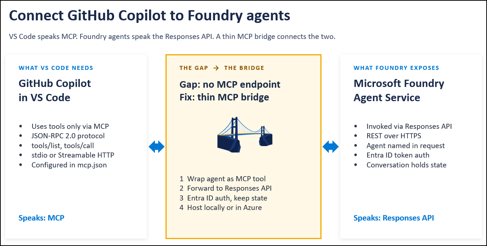
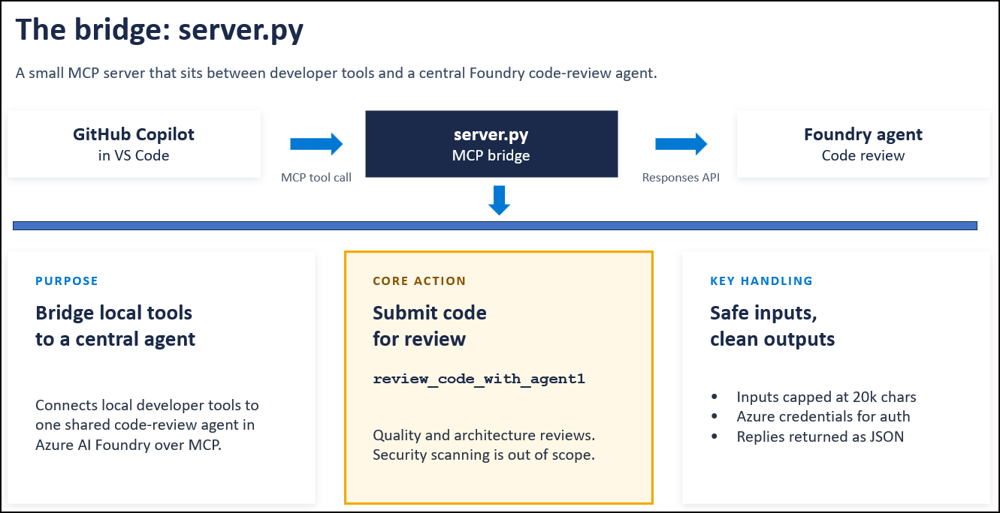
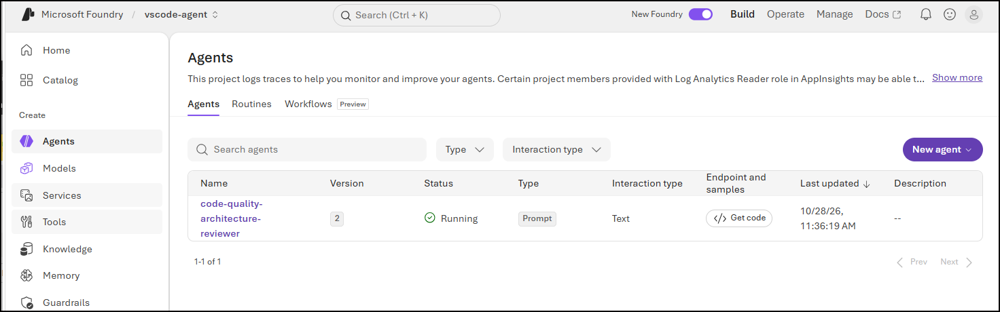
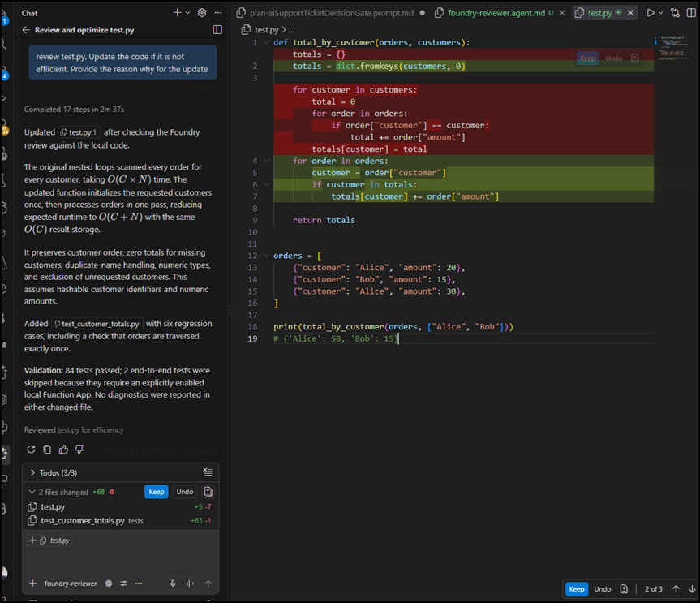

# Foundry Agent MCP Wrapper

A small Python MCP server that exposes an existing Microsoft Foundry agent as an MCP tool. An MCP client sends a code excerpt and a review question to the server; the server forwards them to the configured Foundry agent and returns the agent's review.

This project is a transport wrapper, not an agent host or vulnerability scanner. The Foundry project and agent must already exist, and the agent's instructions determine the review format and behavior.

## Problem and Solution

Teams may already have a central code-review agent in Microsoft Foundry, with shared instructions for code quality and architecture. Developers want to use that agent from GitHub Copilot in VS Code without manually copying code into a separate interface or duplicating the agent's review instructions locally.

The integration gap is that a Foundry agent invoked through the Responses API is not automatically exposed as an MCP tool or added to Copilot's agent dropdown. VS Code can connect to MCP servers, but this workflow needs a bridge that translates an MCP tool call into a request to the configured Foundry agent.



This wrapper provides that bridge. It exposes `review_code_with_agent1` over MCP stdio, accepts the review question and code excerpt, authenticates to Foundry using `DefaultAzureCredential`, calls the named agent through the Responses API, and returns the review to Copilot. The review instructions stay with the central Foundry agent, while developers can request reviews from their editor.



Copilot remains responsible for gathering relevant local code and presenting the findings. With a custom agent configured to use `edit` and `execute`, it can also apply recommendations when requested and run local validation. The remote Foundry agent and this wrapper do not directly edit workspace files.

The diagrams illustrate the broader integration pattern. This implementation runs locally using stdio and does not explicitly create or persist a Foundry conversation across tool calls. The code excerpt limit defaults to 20,000 characters and is configurable. Input limits and JSON parsing do not redact secrets or guarantee safe or correct review output; only submit code you are authorized to share.

## How It Works

1. The server reads the Foundry project endpoint, agent name, and optional code-size limit from environment variables (including a local `.env` file).
2. `DefaultAzureCredential` authenticates the server to Azure.
3. The server gets an OpenAI client for the named Foundry agent.
4. The MCP tool `review_code_with_agent1` validates and packages the caller's question, filename, and code excerpt, then calls the agent.
5. The response is parsed as a JSON object when possible. If the agent returns non-JSON text, the wrapper returns it in `review.raw_review`.

## Requirements

- Python installed on the machine running the server.
- Access to a Microsoft Foundry project and an existing agent in that project.
- An identity supported by `DefaultAzureCredential`, with permission to use the project and agent. For local development, one option is to sign in with Azure CLI using `az login`.
- The project endpoint and agent name.

## Preexisting Foundry Agent

The screenshot below shows the existing Microsoft Foundry agent used with this repository. This agent was already created and configured before the MCP wrapper was implemented; creating or deploying a Foundry agent is not part of this wrapper's setup.



Before configuring the wrapper, create your own Foundry project and agent or obtain access to an existing one. Configure the agent's review instructions in Foundry, then set `FOUNDRY_PROJECT_ENDPOINT` and `FOUNDRY_AGENT_NAME` to identify that project and agent. The wrapper connects to the named agent; it does not provision the project, create the agent, or define its review instructions.

## Configure

From the project directory, create a `.env` file:

```dotenv
FOUNDRY_PROJECT_ENDPOINT=https://<your-project-resource>.services.ai.azure.com/api/projects/<your-project>
FOUNDRY_AGENT_NAME=<your-agent-name>
# Optional. Defaults to 20000 characters.
FOUNDRY_MAX_CODE_CHARS=20000
```

Use the project endpoint shown for your Foundry project. Do not put credentials, keys, or tokens in this file. Keep `.env` out of source control.

## Install and Run

In PowerShell, from the project directory:

```powershell
py -m venv .venv
.\.venv\Scripts\Activate.ps1
python -m pip install -r requirements.txt
az login
python server.py
```

The server uses MCP stdio transport. When launched directly, it waits for an MCP client on standard input and writes the MCP protocol on standard output; it is not an HTTP server. To use it from an MCP client, configure that client to launch `server.py` as a stdio server rather than leaving the command running in a separate terminal.

## Configure an MCP Client

Add a server entry in the MCP client's configuration. This example uses the common `mcpServers` shape; use the equivalent location and schema for your client. Replace the paths and Foundry values with your own:

```json
{
  "mcpServers": {
    "foundry-code-review": {
      "command": "C:\\dev-tools\\foundry-agent-mcp\\.venv\\Scripts\\python.exe",
      "args": [
        "C:\\dev-tools\\foundry-agent-mcp\\server.py"
      ],
      "env": {
        "FOUNDRY_PROJECT_ENDPOINT": "https://<your-project-resource>.services.ai.azure.com/api/projects/<your-project>",
        "FOUNDRY_AGENT_NAME": "<your-agent-name>",
        "FOUNDRY_MAX_CODE_CHARS": "20000"
      }
    }
  }
}
```

The client process also needs a working `DefaultAzureCredential` identity. For example, sign in with Azure CLI in the same user context before starting the client. Restart or reload the MCP client after changing its configuration.

## Use in VS Code Copilot

Registering this MCP server makes its tools available to Copilot; it does not automatically add the remote Foundry agent to the Chat agent dropdown. You can use the tool from ordinary **Agent** mode without a custom agent file. To give this integration its own named dropdown entry, create a VS Code custom agent.

### Register the MCP Server

In the workspace where you want to review code, add the following to `.vscode/mcp.json`. VS Code uses `servers`, not the generic `mcpServers` key shown above. Replace the paths and Foundry values:

```json
{
  "servers": {
   "foundry-code-review": {
    "type": "stdio",
    "command": "C:\\dev-tools\\foundry-agent-mcp\\.venv\\Scripts\\python.exe",
    "args": ["C:\\dev-tools\\foundry-agent-mcp\\server.py"],
    "env": {
      "FOUNDRY_PROJECT_ENDPOINT": "https://<your-project-resource>.services.ai.azure.com/api/projects/<your-project>",
      "FOUNDRY_AGENT_NAME": "<your-agent-name>",
      "FOUNDRY_MAX_CODE_CHARS": "20000"
    }
   }
  }
}
```

Authentication must already be configured as described above. After saving the MCP configuration, check that the server is running:

1. Press **Ctrl+Shift+P** to open the VS Code Command Palette.
2. Run **MCP: List Servers**.
3. Select **foundry-code-review**.
4. If the server is not running, select **Start Server**. Approve any trust prompt only after reviewing the configuration.
5. Confirm that `review_code_with_agent1` is available and enabled in Chat's tool picker before requesting a review.

Alternatively, use the **Start** action above the server entry in the MCP configuration editor. If startup fails, use **MCP: List Servers**, select the server, and choose **Show Output** to inspect its logs.

### Add a Dropdown Agent

Create `.github/agents/foundry-reviewer.agent.md` relative to the workspace root. The standard workspace location is `.github/agents`, not `.agents`. Put the file in the project you are reviewing; it does not have to live beside this wrapper's Python source.

```markdown
---
name: Foundry Code Reviewer
description: Review code quality and architecture using Microsoft Foundry and apply recommendations when requested.
tools: ['read', 'search', 'edit', 'execute', 'foundry-code-review/*']
---

Review code using the MCP tool review_code_with_agent1 and apply its recommendations when the user requests changes.

1. Identify the user's review question and the selected code or requested file.
  Ask for missing context when necessary.
2. Read only the relevant code. Do not send secrets or unrelated files.
  Code sent to the tool leaves this machine for the configured Foundry project.
3. Call review_code_with_agent1 with developer_question, code_context, and filename.
  Keep each excerpt within the configured FOUNDRY_MAX_CODE_CHARS limit
  (20,000 characters by default). Ask the user to narrow oversized requests.
4. Present the returned findings and prioritized actions, with file references
  where supported by the result. Do not claim vulnerability scanning.
5. For review-only requests, do not modify files. When the user asks to apply
  recommendations, evaluate them against the current code, make focused edits,
  and preserve unrelated user changes. Ask for clarification if the intended
  behavior is ambiguous.
6. After editing, run relevant tests, linters, or type checks using the project's
  existing commands. Report the changes, validation results, and any checks
  that could not be run. Do not commit or push unless explicitly requested.
7. If the tool is unavailable or fails, report that failure explicitly.
  Do not present a local review as a successful Foundry review.
```

The `foundry-code-review/*` tool entry must match the server key in `.vscode/mcp.json`. It enables tools from that MCP server; `read` and `search` let Copilot gather the requested code. The displayed `name` can differ from `FOUNDRY_AGENT_NAME`: the former names the Copilot persona, while the latter selects the remote Foundry agent.

The `edit` alias lets the Copilot custom agent update workspace files. The `execute` alias lets it run terminal commands, such as tests and linters; it is not required merely to edit a file. These are tool names, not `-edit` or `-execute` flags. A YAML block list with entries such as `- edit` and `- execute` is also valid under `tools:`. Tool availability and approvals remain subject to VS Code settings and organizational policies. Remove `execute` if terminal access is not needed, or remove both `edit` and `execute` for a read-only reviewer.

The Foundry MCP wrapper itself still only returns review recommendations. Copilot applies the requested changes locally through `edit` and runs validation through `execute`; adding these aliases does not give the remote Foundry agent direct access to local files. For example, ask: "Review the attached file using Foundry, apply the relevant recommendations, and run the existing tests."

Open Copilot Chat, select **Foundry Code Reviewer** from the agent dropdown, attach the relevant file or selection, and ask for a review. If the entry does not appear, check the file location and YAML frontmatter, then reload the VS Code window. This custom agent still uses a Copilot model to coordinate the request; the review itself is delegated to Foundry through the MCP tool.

See the VS Code documentation for [custom agents](https://code.visualstudio.com/docs/copilot/customization/custom-agents) and [MCP servers](https://code.visualstudio.com/docs/copilot/customization/mcp-servers).

## Use the Tool

Call `review_code_with_agent1` with:

| Argument | Required | Description |
| --- | --- | --- |
| `developer_question` | Yes | What you want the agent to review. Whitespace-only input is rejected; the wrapper forwards at most 2,000 characters. |
| `code_context` | Yes | The code or file excerpt to review. Whitespace-only input is rejected. Its size must not exceed `FOUNDRY_MAX_CODE_CHARS` (20,000 by default). |
| `filename` | No | A label for the supplied code. Defaults to `not-provided`; the wrapper forwards at most 500 characters. |

Example request:

```json
{
  "developer_question": "Review this function for maintainability and suggest focused improvements.",
  "filename": "src/parser.py",
  "code_context": "def parse_record(value):\n    ..."
}
```

The result includes the configured `agent_name`, the `filename`, `characters_reviewed`, and a `review` object. When the agent returns valid JSON, that JSON object is used as `review`. Otherwise, `review` contains a summary and the original text in `raw_review`.

Only send code and context that you are authorized to share with the configured Foundry project. The wrapper forwards the supplied code to the agent; it does not redact secrets or scan for vulnerabilities. Do not include credentials or other sensitive values in a review request.

## Example User Experience

The screenshot below shows a user asking Copilot to review a Python file, improve its efficiency, and explain the changes. The recommendation behind the code highlighted in green was produced by the remote Foundry agent in response to the request prompt shown in the screenshot. Copilot applied the recommendation locally; the green blocks show added code in VS Code's diff view, while the red blocks show removed code.



## Legal Disclaimer

This repository is provided for educational and demonstration purposes only. The code, documentation, and any agent-generated output are provided "AS IS" and "AS AVAILABLE", without warranty of any kind, express or implied, including warranties of merchantability, fitness for a particular purpose, and noninfringement.

To the maximum extent permitted by applicable law, the author and contributors shall not be liable for any claims, damages, losses, costs, or other liability arising from or related to the use, misuse, modification, distribution, or inability to use this repository or its outputs, whether in contract, tort, or otherwise. This includes data loss, security incidents, service interruptions, cloud charges, and reliance on inaccurate or incomplete AI-generated output.

You are responsible for evaluating, testing, securing, and operating the code; reviewing all AI-generated output before relying on it; obtaining permission to share submitted data; and complying with applicable laws, organizational policies, and third-party service terms. Use this repository at your own risk. Nothing in this disclaimer excludes or limits liability that cannot lawfully be excluded or limited.

This disclaimer does not itself grant a license to use, modify, or redistribute the code.

## Troubleshooting

- **Missing environment variable:** Confirm `FOUNDRY_PROJECT_ENDPOINT` and `FOUNDRY_AGENT_NAME` are present in the process environment or in the `.env` file loaded from the project directory.
- **Authentication or authorization failure:** Confirm `DefaultAzureCredential` can obtain a token and that the signed-in identity can access the Foundry project and agent.
- **Agent not found:** Check that the configured agent name matches an existing agent available in the configured project.
- **Input too large:** Send a smaller excerpt or increase `FOUNDRY_MAX_CODE_CHARS` to an appropriate limit.
- **Client cannot start the server:** Check the Python executable and `server.py` paths in the MCP client configuration, then reload the client and inspect its MCP server logs.